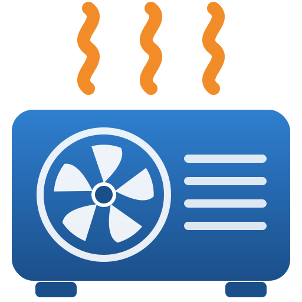

# Avarma R290 Wärmepumpe in Home Assistant

Komplette Einbindung einer **Avarma (Hofman Energy) R290 Monoblock-Wärmepumpe** in Home Assistant über Modbus/RS485. Es braucht kein ESPHome und keine Cloud: Ein RS485-Ethernet-Gateway hängt an der Wärmepumpe, Home Assistant liest und schreibt direkt.

### Getestete Anlage

| | |
|---|---|
| Wärmepumpe | **Avarma (Hofman Energy) R290 Monoblock, 9 kW** |
| Hauptplatine, Modell (Register 4352) | 23557 (0x5C05) |
| Hauptplatine, Software (Register 4353 / 4615) | 1518 |
| Display-Software (Register 4616) | wird nicht über Modbus gemeldet (0) |
| Modbus | RTU, 9600 8N1, Slave 1, über COMM3 |
| Home Assistant | Core 2026.2 auf Raspberry Pi 5 |

> Andere Leistungsgrößen und Softwarestände sollten mit demselben Regler ähnlich funktionieren, sind aber **nicht getestet**. Deine Werte siehst du nach der Installation im Dashboard unter **Diagnose** („WP Software Platine“). Über Rückmeldungen mit Modell und Softwarestand freue ich mich.

> 🤖 **Komplett mit [Claude](https://claude.ai) (Anthropic) erstellt.** Registeranalyse, Home-Assistant-Integration, Dashboard, Display-Nachbau, Parameterliste und diese Anleitung sind im Dialog mit Claude entstanden. Getestet und abgeglichen an der echten Anlage.

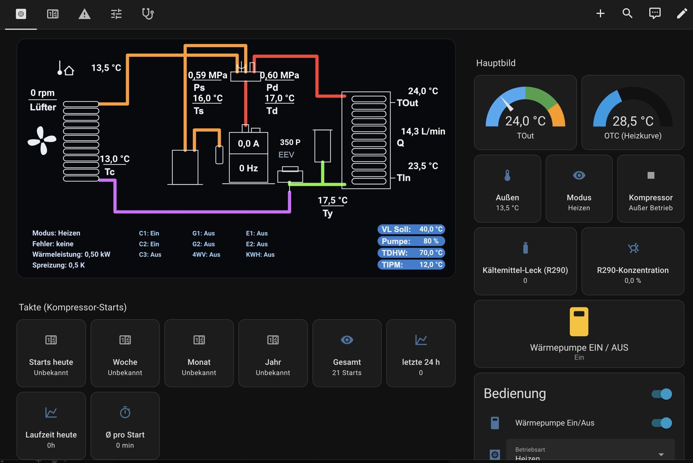

| Smartphone | Original-Display „Arbeitsstatus“ |
|---|---|
| 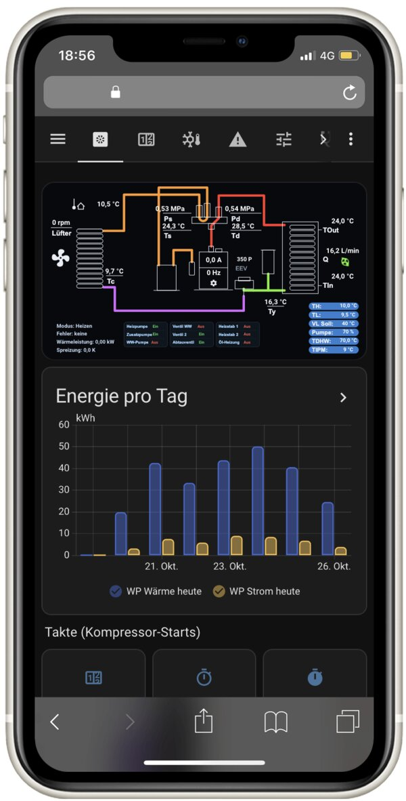 | 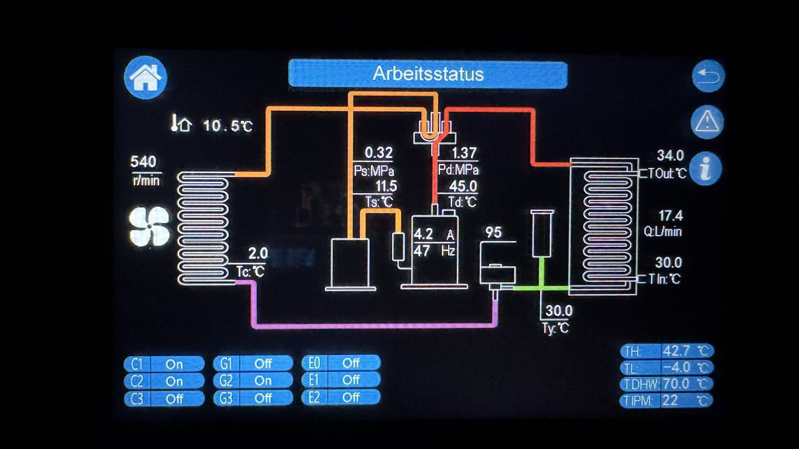 |

---

## Was du bekommst

- **Nachgebautes Display „Arbeitsstatus“**: Kältekreis mit allen Live-Werten (Ps/Pd, Ts/Td/Tc, TOut/TIn, Q, Ty, Kompressor A/Hz, EEV, Lüfter) und den Ausgängen C1–C3, G1/G2, E1/E2, 4-Wege-Ventil und Öl-Heizung (Verdichter-Heizband).
- **Hauptbild** mit TOut und OTC (Heizkurven-Soll), **EIN/AUS-Knopf** mit Sicherheitsabfrage, **Betriebsart** (Heizen / WW / Kühlen …) und **Nachtmodus** samt Uhrzeiten.
- **Takt-Zählung**: Kompressor-Starts heute, Woche, Monat, Jahr und gesamt (aus dem internen Zähler der WP), dazu Laufzeit, Ø Laufzeit pro Start, Balkendiagramme und eine Aufzeichnung jedes Starts und Stopps.
- **Kältekreis-Ampel**: Kondensations- und Verdampfungstemperatur (TH/TL wie am Display), Überhitzung, Unterkühlung und Temperaturhub mit Richtwerten und verständlicher Erklärung.
- **Energie** aus den Zählern der Wärmepumpe (wie am Display): Wärme, Strom, erneuerbar, COP heute, JAZ.
- **Fehler**:
  - aktive Fehler im Klartext (E01–E59, Treiberfehler)
  - Fehlerspeicher der WP
  - Fehler quittieren per Knopf
  - Benachrichtigung bei Störung in Home Assistant und als Push aufs Handy (mit Fehlertext)
- **R290-Kältemittel-Alarm**: kritische Push-Nachricht, falls die WP Kältemittel meldet (sofern ein Sensor verbaut ist, siehe unten).
- **Alle Parameter P00–P150 und P201–P208 lesen UND ändern**:
  - aufgeteilt in **Benutzer-Parameter** (blau am Display, Benutzer-Code) und **Techniker-Parameter** (weiß am Display, Techniker-Code)
  - jeweils mit deutscher Erklärung und erlaubtem Bereich
  - Änderungen landen im Logbuch
  - Werksreset, RS485-Adresse und Kompressormodell sind gesperrt
- **Uhr der Wärmepumpe** wird täglich automatisch gestellt.

### Screenshots

| Takte & Energie | Fehler |
|---|---|
| 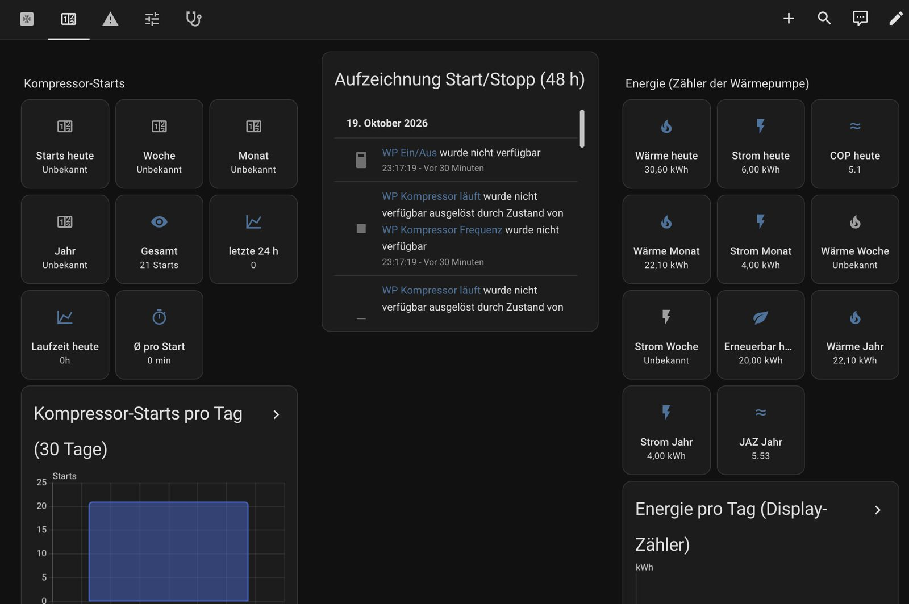 | 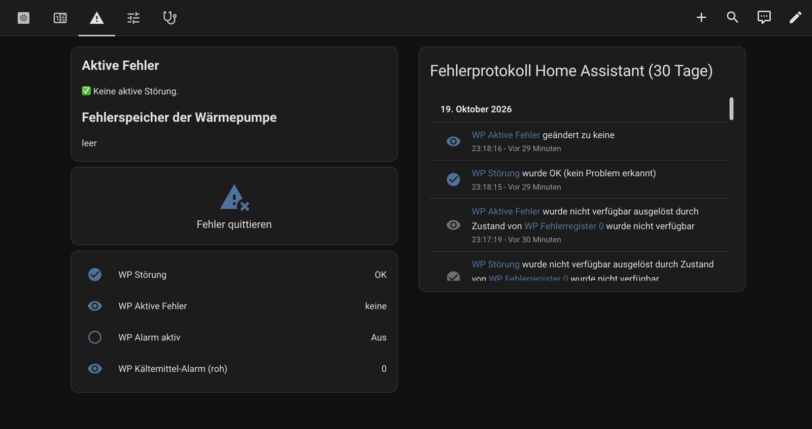 |
| **Parameter** | **Benutzer-Parameter** |
| 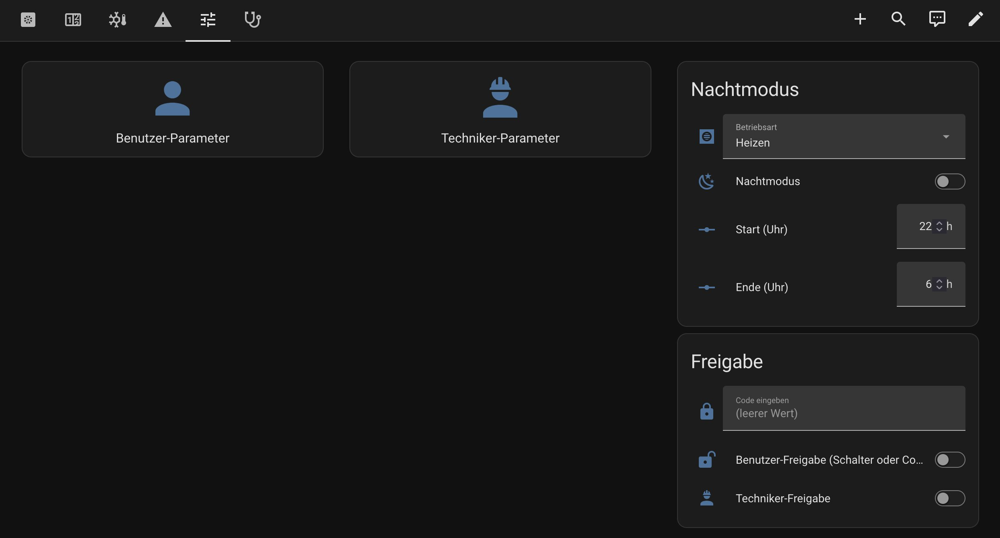 | 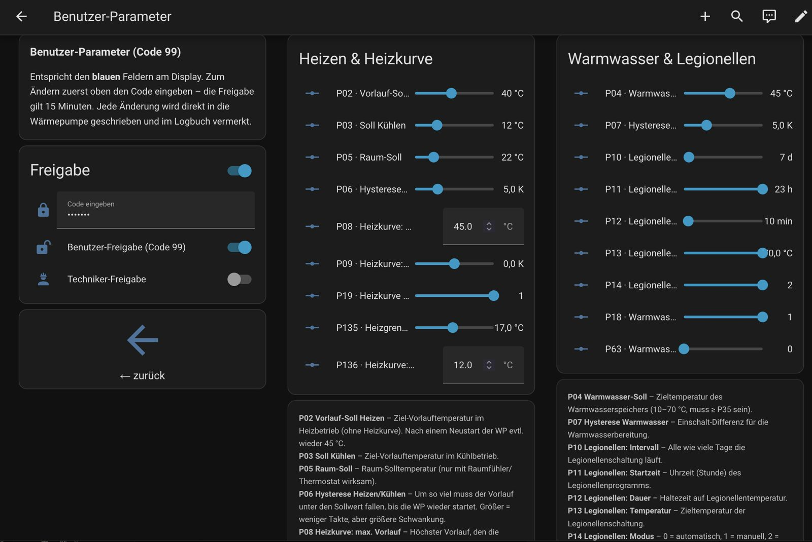 |
| **Diagnose** | **Smartphone** |
| 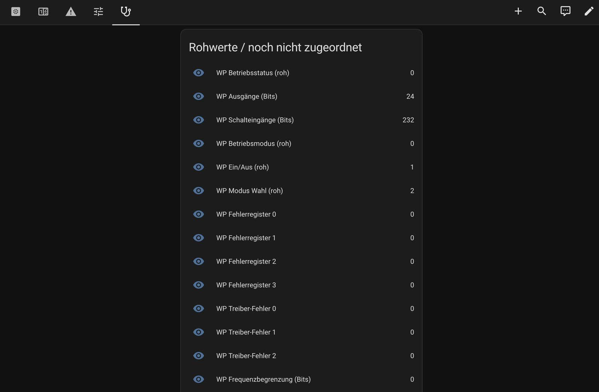 |  |

---

## 1. Hardware

| Teil | Hinweis |
|---|---|
| Avarma / Hofman R290 Monoblock | getestet: 9 kW |
| **RS485 ↔ Ethernet-Gateway** | getestet: **USR-TCP232-304**. Möglich sind auch Elfin EW11/EW11A (WLAN) oder Waveshare RS485 TO ETH |
| 2-adrige Leitung (verdrillt) | A/B, optional GND |

> **USB-RS485-Stick:** Die Integration spricht nur über das Netzwerk (Modbus TCP / RTU over TCP). Ein USB-Stick geht nur mit einem Umweg wie `ser2net`, deshalb ist ein Gateway die einfachere Lösung.
> ⚠️ **Nicht** geeignet: USB-RS232-Adapter mit passivem RS232→RS485-Wandler (z. B. „STM485S“) und reine USB-TTL-Adapter. Die liefern kein Signal.

## 2. Anschluss an der Wärmepumpe

> ⚠️ **Wärmepumpe vorher allpolig stromlos schalten.** Im Gerät liegen 230 V an, und es enthält R290 (Propan).

### 2.1 Klemmleiste: Klemmen 11 (A) und 12 (B)
Die RS485-Leitung zum Gateway kommt an die Kundenklemmen **11 = A** und **12 = B** („RS485 – User wiring“).

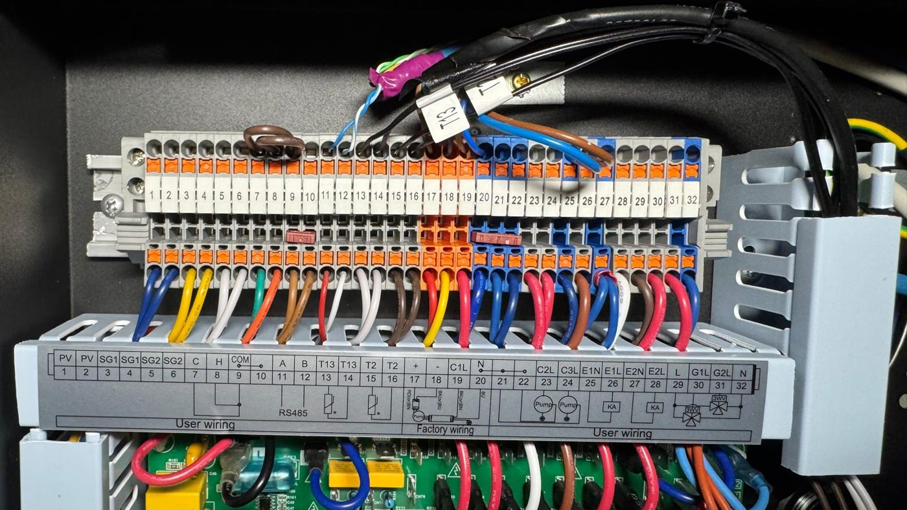

### 2.2 Hauptplatine: grünen Stecker von COMM2 auf COMM3 umstecken
**Ab Werk geht von 11/12 noch keine Kommunikation aus.** Intern führen die Klemmen 11/12 über einen grünen 4-poligen Stecker (`+12V G A B`) auf **COMM2**, und COMM2 ist für Modbus nicht aktiv.

**Lösung:** Die beiden grünen Stecker auf der Hauptplatine **tauschen**. Der Stecker mit der Leitung von 11/12 kommt auf **COMM3** (`+12V G A3 B3`), der andere auf COMM2. An der Klemmleiste ändert sich nichts.

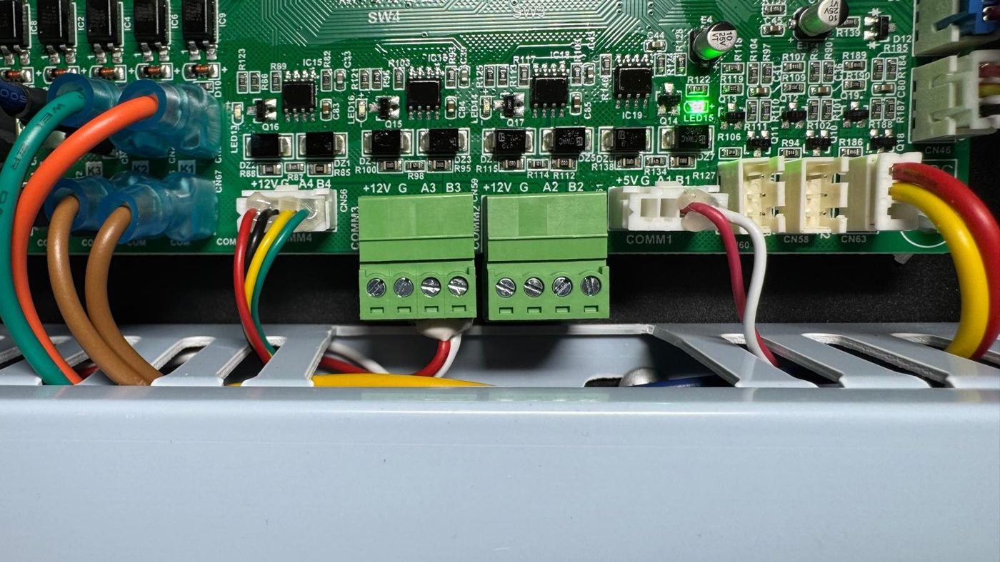

| Anschluss | Funktion |
|---|---|
| COMM1 (`+5V G A1 B1`) | **Original-Display**, nicht anfassen |
| COMM2 (grün) | ab Werk mit 11/12 verbunden, für Modbus inaktiv |
| **COMM3 (grün, `A3 B3`)** | **Modbus für Home Assistant** ✅ (Slave 1) |
| COMM4 (`+12V G A4 B4`) | ab Werk belegt, nicht anfassen |

### 2.3 Gateway anschließen
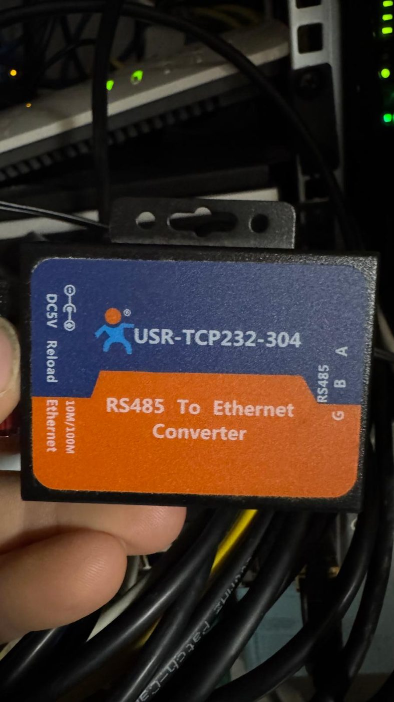

Am USR-TCP232-304:
- **A** ← Klemme 11
- **B** ← Klemme 12
- **G** optional an Masse
- Versorgung **5 V DC**, Netzwerk an den Switch bzw. Router.

Kommt keine Antwort, tausch A und B einmal (manche Hersteller beschriften verkehrt herum). Laufen Display und Home Assistant gleichzeitig, ist das kein Problem, weil sie an getrennten Ports hängen (Display an COMM1, Home Assistant an COMM3).

 

## 3. Gateway einrichten (USR-TCP232-304)

In der Weboberfläche des Gateways (Zugangsdaten laut Handbuch; **ändere das Standard-Passwort**):

| Einstellung | Wert |
|---|---|
| Baudrate | **9600** |
| Data / Parity / Stop | **8 / None / 1** |
| Work Mode | **TCP Server** |
| Local Port | **502** |
| Modbus-TCP-Umwandlung | **aus** (transparent) |

Gib dem Gateway im Router eine **feste IP** (DHCP-Reservierung).

## 4. Home Assistant einrichten

Voraussetzungen: Home Assistant ab 2025.1 und [HACS](https://hacs.xyz/docs/use/).

### 4.1 Integration über HACS installieren

1. Auf den Button klicken, die eigene Home-Assistant-Instanz bestätigen und in HACS **Herunterladen** wählen.
   Ohne Button: HACS → ⋮ → *Benutzerdefinierte Repositories* → `https://github.com/KaHu85/avarma-homeassistant`, Typ *Integration* → hinzufügen, dann „Avarma Wärmepumpe“ suchen und herunterladen.
2. Home Assistant **neu starten**.

Manuell ohne HACS

Den Ordner `custom_components/avarma` aus diesem Repository nach `<config>/custom_components/avarma` kopieren (z. B. per Samba- oder File-Editor-Add-on) und Home Assistant neu starten. Updates kommen dann nicht automatisch.

### 4.2 Wärmepumpe hinzufügen

1. Auf den Button klicken oder: Einstellungen → Geräte & Dienste → **Integration hinzufügen** → „Avarma Wärmepumpe“.
2. Eintragen:
   - **IP-Adresse** des Gateways
   - **Port:** `502`
   - **Slave-ID:** `1`
   - **Protokoll:** *RTU over TCP* (Gateway transparent, wie in Abschnitt 3) bzw. *Modbus TCP*, wenn dein Gateway selbst umsetzt
3. Beim Speichern wird die Verbindung geprüft. Klappt das nicht: Protokoll, A/B-Verdrahtung und 9600 8N1 am Gateway kontrollieren.

> Es darf **nur ein** System gleichzeitig die Wärmepumpe über das Gateway abfragen. Zwei Abfragen auf demselben Bus stören sich gegenseitig.

### 4.3 Optionen (Gerät → ⚙️ **Konfigurieren**)

| Option | Bedeutung |
|---|---|
| **Techniker-Code** | Derselbe Code wie am Display deiner Anlage (vom Installateur bzw. Hersteller). Er wird nur lokal in Home Assistant gespeichert. Leer = Techniker-Parameter bleiben gesperrt. |
| **Techniker-Freigabe per Schalter erlauben** | Aus = Techniker-Parameter nur nach Eintippen des Codes. Ein = der gespeicherte Code genügt, der Schalter „Techniker-Freigabe“ gibt die Parameter für 15 Minuten frei. Nur einschalten, wenn niemand Unbefugtes Zugriff auf dein Home Assistant hat. |
| **Push-Benachrichtigung an** | z. B. `notify.mobile_app_mein_iphone` für Störungen und den R290-Alarm. Den Namen findest du unter Entwicklerwerkzeuge → Aktionen → „notify.“. |
| **Uhr täglich stellen** | stellt die Uhr der Wärmepumpe jeden Tag um 03:17 |
| **Abfrageintervall** | Standard 10 s (Parameter alle 15 min, Energiezähler alle 5 min) |

### 4.4 card-mod installieren
Das nachgebaute Display braucht **card-mod** (HACS → Frontend → „card-mod“), damit die Schrift mit dem Bild mitskaliert. Das Schema-Bild selbst bringt die Integration mit.

### 4.5 Dashboard anlegen
1. Einstellungen → Dashboards → **Dashboard hinzufügen** → „Neues Dashboard von Grund auf“ → Name „Wärmepumpe“, URL `waermepumpe`.
2. Dashboard öffnen → ✏️ → ⋮ → **Raw-Konfigurationseditor**.
3. Den gesamten Inhalt von [`homeassistant/dashboards/waermepumpe.yaml`](homeassistant/dashboards/waermepumpe.yaml) einfügen → Speichern.

> Die Unterseiten „Benutzer-Parameter“ und „Techniker-Parameter“ verlinken auf `/waermepumpe/…`. Nimmst du eine andere URL, passe die `navigation_path`-Einträge an.

### 4.6 Umstieg vom früheren YAML-Paket
Wer die ältere Version mit `packages/avarma.yaml` nutzt (Stand: Branch [`yaml-paket`](https://github.com/KaHu85/avarma-homeassistant/tree/yaml-paket)):
1. `packages/avarma.yaml` löschen (und `www/avarma/schema.svg`, wird nicht mehr gebraucht). Wird die Datei in der `configuration.yaml` einzeln eingebunden (z. B. `avarma: !include packages/avarma.yaml`), diese Zeile ebenfalls entfernen, sonst startet Home Assistant im Wiederherstellungsmodus. Dann neu starten.
2. Integration installieren und einrichten wie oben. Solange das alte Paket noch aktiv ist, startet die Integration absichtlich nicht.
3. Die Entitäten heißen wie vorher (z. B. `sensor.wp_vorlauf_tout`), dadurch laufen **Verläufe und Statistiken weiter**. Die Zähler (Starts, Wärme/Strom Woche/Monat/Jahr, Laufzeit) werden beim ersten Start aus der Historie übernommen.
4. Dashboard neu einfügen (Abschnitt 4.5). Geändert haben sich nur Code-Feld und Freigaben: `text.wp_code_eingeben`, `switch.wp_benutzer_freigabe`, `switch.wp_techniker_freigabe`.

---

## 5. Bedienung

| Reiter | Inhalt |
|---|---|
| **Arbeitsstatus** | Display-Nachbau, Hauptbild, EIN/AUS, Betriebsart, Nachtmodus, Takte, Status, Verläufe |
| **Kältekreis** | TH/TL, Überhitzung, Unterkühlung, Temperaturhub mit Ampel und ausführlicher Erklärung, was gut und was schlecht ist |
| **Takte & Energie** | Starts Tag/Woche/Monat/Jahr/gesamt, Ø Laufzeit, Start/Stopp-Aufzeichnung, Energie, COP, JAZ |
| **Fehler** | aktive Fehler im Klartext, Fehlerspeicher, **Fehler quittieren**, Protokoll |
| **Parameter** | → **Benutzer-Parameter** / **Techniker-Parameter**, Nachtmodus, Freigabe |
| **Diagnose** | alle Rohwerte und Bits |

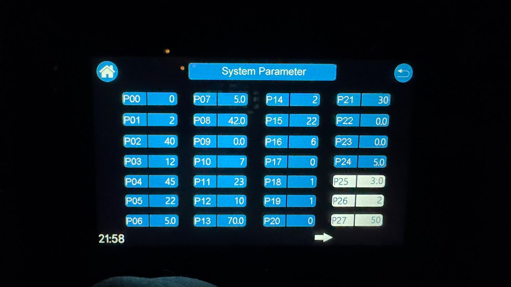

### Parameter ändern
1. **Benutzer-Freigabe** einschalten (oder im Feld **Code** `99` eingeben und Enter drücken). Techniker-Parameter: Techniker-Code eingeben bzw. – falls in den Optionen erlaubt – den Schalter **Techniker-Freigabe** umlegen. Die Freigabe gilt **15 Minuten**.
2. Wert ändern. Er wird sofort per Modbus in die Wärmepumpe geschrieben, zurückgelesen und im **Logbuch** vermerkt.
3. Ohne Freigabe wird **nichts** geschrieben, und Home Assistant zeigt einen Hinweis.

> ⚠️ **Techniker-Parameter sind gefährlich!** Sie steuern Kältekreis, Verdichter, Expansionsventil, Schutz- und Abtaufunktionen. Falsche Werte können die Wärmepumpe in Dauerstörung bringen, den Verdichter beschädigen oder Schutzabschaltungen aushebeln, und eventuell geht die Garantie verloren. **Ändere dort nur etwas, wenn du genau weißt, was der Parameter bewirkt.** Notiere vorher den alten Wert und frag im Zweifel den Hersteller oder Fachbetrieb.

Die komplette Liste mit Adressen, Bereichen und Erklärungen steht in **[docs/parameter.md](docs/parameter.md)**, alle Register in **[docs/register.md](docs/register.md)**.

 

### Takte (Kompressor-Starts)
Grundlage ist der **interne Startzähler der Wärmepumpe** (Register 4608). Er zählt also auch Starts, bevor Home Assistant lief. Viele Starts mit kurzer Ø-Laufzeit heißt: Die Anlage taktet. Stellschrauben dafür sind z. B. **P06** (Hysterese), **P46** (Mindestfrequenz) und **P114** (Frequenzreduktion).

### Energie
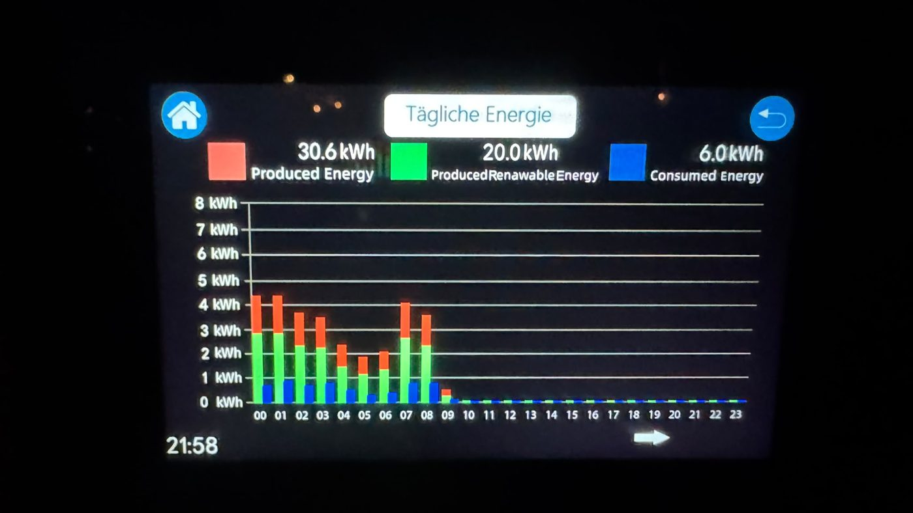

Die Werte kommen direkt aus den Energiezählern der Wärmepumpe (dieselben wie am Display unter „Tägliche/Monatliche Energie“). Die Zähler für Woche, Monat und Jahr können auch im **Energie-Dashboard** verwendet werden.

 

### R290-Kältemittel-Alarm
Der Alarm wird ausgelöst bei Alarm-Flag, Konzentration > 0 **oder** Fehler **E51**. Dann gibt es eine Meldung in Home Assistant und eine kritische Push-Nachricht.
> ⚠️ **Ob bei meiner Anlage überhaupt ein R290-Konzentrationssensor verbaut ist, weiß ich selbst nicht sicher.** Meine 9 kW meldet als Konzentration 0 und als **Alarmgrenze 0**. Das spricht eher dafür, dass kein Sensor aktiv ist. Ob ein Sensor verbaut ist, hängt vom Modell ab, bitte beim Hersteller erfragen.
> **Diese Funktion ersetzt keinen Gaswarnmelder.** Den Sensor bitte **nicht** selbst mit Feuerzeuggas testen (brennbares Gas im Gerät mit Elektrik).

---

## 6. Für Bastler

| Datei | Zweck |
|---|---|
| `custom_components/avarma/params.py` | Parameterliste: Display-Nummer → Adresse, Skalierung, Bereich, Ebene, Erklärung |
| `custom_components/avarma/` | die Integration (eigener schlanker Modbus-Client, keine Zusatzpakete) |
| `tools/dash2.py` | erzeugt das Dashboard (`homeassistant/dashboards/waermepumpe.yaml`) |
| `tools/entity_map.json` | Zuordnung Schlüssel → Entity-ID für den Dashboard-Generator |

Ereignis für eigene Automationen: `avarma_stoerung` (Daten: `fehler` = neue Fehler, `alle` = alle aktiven).

## 7. Hinweise und offene Punkte

- **Adress-Falle:** Die Hofman-Liste hat zwei Spalten. Immer **„Decimal“** verwenden, nicht „Decimal+1“.
- Parameter-Register **nicht im Dauertakt schreiben**. Ob jeder Schreibvorgang ins EEPROM geht, ist unbekannt.
- Die Integration liest Parameter nur alle 15 Minuten (und direkt nach dem Schreiben), Live-Werte alle 10 Sekunden.
- Bekannte Abweichungen Display ↔ Register: **P34** (Display 0 / Register 400), **P116** (0 / 1).
- Unklar ist noch die Bedeutung von **P137–P150**.

## 8. Haftung

Alles auf eigene Gefahr. Falsche Parameter können die Wärmepumpe in Störung bringen oder beschädigen, und Garantiefragen klärt jeder selbst. Arbeiten im Gerät nur stromlos. Es enthält brennbares Kältemittel (R290).

## Danke

- [holle74/avarma-eigenbau-regelung](https://github.com/holle74/avarma-eigenbau-regelung): ESPHome-Konfiguration und viel Vorarbeit zu den Registern
- [Akkudoktor-Forum: Wiki Avarma R290](https://akkudoktor.net/t/wiki-avarma-290-waermepumpe-monoblock/41521) und [Thread AVARMA WP Monoblock](https://akkudoktor.net/t/avarma-wp-monoblock-r290/16194): u. a. der Hinweis auf RS485-3 / COMM3
- Erstellt mit [Claude](https://claude.ai) von Anthropic
- Hofman Energy: Modbus-Protokoll *HE-AI-290-00-000V-V03 TDB* (nicht enthalten, beim Hersteller bzw. Händler erhältlich)

## Lizenz

**CC BY-NC-SA 4.0**: Frei für private, nicht kommerzielle Nutzung mit Namensnennung. Bearbeitungen müssen unter derselben Lizenz weitergegeben werden. Kommerzielle Nutzung nur mit Erlaubnis. Details siehe [LICENSE](LICENSE).
